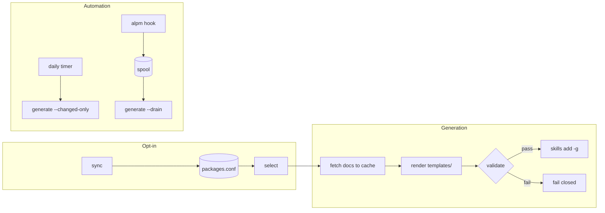

# pkg-skills

Index the packages installed on your system (pacman, cargo, bun, npm, pnpm,
yarn, mise, go, pipx, deno, uv) and auto-generate a rich Claude skill for each
one you opt in — docs, cheatsheet, parameterized examples, snippets, and a
refresh script — kept current by a systemd timer and a pacman hook.

## Contents

- [Background & Motivation](#background--motivation)
- [Quick Start](#quick-start)
- [Lifecycle](#lifecycle)
- [Command Reference](#command-reference)
- [Configuration](#configuration)
- [Automation](#automation)
- [File Locations](#file-locations)
- [Troubleshooting](#troubleshooting)
- [Related Documentation](#related-documentation)

## Background & Motivation

Every tool on a workstation has documentation an agent could use — but fetching
`--help`, man pages, READMEs, and changelogs on every session burns tokens and
time. pkg-skills inverts that: a deterministic pipeline snapshots those
artifacts into per-package skills once, validators enforce Anthropic's skill
best practices, and OS-level hooks regenerate exactly the packages that
changed. The agent's job shrinks to curation — which is opt-in and runs
entirely against local files.

## Quick Start

```bash
cd plugins/pkg-skills
bun install
bun run build                      # compiles ./dist/pkg-skills (standalone)

pkg-skills sync                    # enumerate installed packages -> packages.conf
pkg-skills select                  # space-to-toggle opt-in TUI
pkg-skills generate                # build + install skills for opted-in packages
pkg-skills units install           # systemd units + alpm hook instructions
systemctl --user enable --now pkg-skills.timer pkg-skills-drain.path
```

## Lifecycle



## Command Reference

| Command | Arguments | Description |
|---------|-----------|-------------|
| `sync` | — | refresh packages.conf from every available manager (idempotent) |
| `select` | — | interactive opt-in toggle (space/enter), writes packages.conf |
| `list` | — | opt-in state per package |
| `generate` | `[pkg…] [--changed-only] [--drain]` | fetch → render → validate → `skills add` |
| `fetch` | `<pkg>` | refresh one package's doc cache |
| `meta` | `<pkg>` | template variables as JSON (drives `/pkg-skills-scaffold`) |
| `validate` | `<skill-dir>` | best-practices lint; non-zero exit on errors |
| `units` | `install\|enable\|disable\|status` | systemd/alpm automation management |
| `status` | — | paths, managers, opt-in summary |

Slash commands: `/pkg-skills` (status + routing), `/pkg-skills-sync`,
`/pkg-skills-select`, `/pkg-skills-generate`, `/pkg-skills-scaffold`
(agent-rendered templates), `/pkg-skills-enrich`.

## Configuration

`$XDG_CONFIG_HOME/pkg-skills/config.toml` (all keys optional):

```toml
enrich = "off"            # "headless" runs claude -p after generating
github = true             # fetch README/releases/changelog from GitHub
prefix = "pkg-"           # generated skill name prefix
skills_add_args = "-g -y" # extra args for `skills add`
mirror_claude_dirs = true # copy reference/snippets into ~/.claude/
# output_dir = "~/.local/share/pkg-skills/generated"
```

`packages.conf` is the opt-in list: uncomment a line to opt in. Sync never
touches your choices.

## Automation

`pkg-skills units install` writes four user units (timer + service,
path + drain service) and prints the sudo commands for the alpm hook. Pacman
installs/upgrades regenerate instantly via the spool; cargo/bun/npm/… changes
are caught by the daily `--changed-only` timer run. Details:
[skills/pkg-skills/references/systemd-alpm.md](skills/pkg-skills/references/systemd-alpm.md).

## File Locations

| Path | Purpose |
|------|---------|
| `$XDG_CONFIG_HOME/pkg-skills/` | config.toml, pkg-skills.conf (env), packages.conf |
| `$XDG_CACHE_HOME/pkg-skills/<manager>__<pkg>/` | fetched doc artifacts |
| `$XDG_STATE_HOME/pkg-skills/state.json` | generation hashes |
| `$XDG_DATA_HOME/pkg-skills/generated/` | staging before `skills add` |
| `~/.agents/skills/pkg-<name>/` | canonical installed skills (symlinked everywhere) |

## Troubleshooting

- **package not listed** — only *explicit* installs are enumerated (`pacman -Qqe`); dependencies are skipped by design.
- **no help/man in the skill** — binary name may differ from the package; pacman file lists resolve this automatically, other managers fall back to the package name.
- **generation "FAILED"** — the validator failed closed; findings are printed. Fix and re-run.
- **timer silent** — `journalctl --user -u pkg-skills.service -e`.

## Related Documentation

- [skills/pkg-skills/references/architecture.md](skills/pkg-skills/references/architecture.md)
- [skills/pkg-skills/references/output-skill-anatomy.md](skills/pkg-skills/references/output-skill-anatomy.md)
- [templates/VARIABLES.md](templates/VARIABLES.md)
- [evals/evals.json](evals/evals.json)
