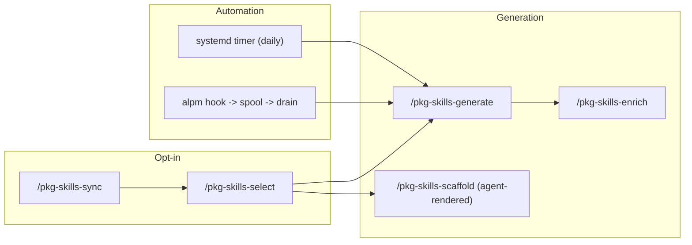

# pkg-skills — package → skill pipeline

## Contents

- [Current status](#current-status)
- [Lifecycle](#lifecycle)
- [Command reference](#command-reference)
- [File locations](#file-locations)
- [Troubleshooting](#troubleshooting)

## Current status

!`pkg-skills status 2>/dev/null || bun run ${CLAUDE_PLUGIN_ROOT}/src/index.ts status`

## Lifecycle

Interpret the status output above for the user, then recommend the next step:
no packages.conf → sync; nothing opted in → select; opted in but no skills →
generate; everything generated → suggest enabling the automation
(`pkg-skills units install`).

## Command reference

| Command | Purpose | Side effects |
|---------|---------|--------------|
| `/pkg-skills-sync` | Refresh packages.conf from all package managers | writes packages.conf |
| `/pkg-skills-select` | Space-to-toggle opt-in TUI | writes packages.conf |
| `/pkg-skills-generate [pkg…]` | Deterministic skill generation | writes skills, runs `skills add` |
| `/pkg-skills-scaffold <pkg>` | Agent-rendered generation from templates/ | writes one skill |
| `/pkg-skills-enrich <pkg>` | Improve prose of an existing generated skill | edits one skill |

## File locations

| File | Purpose |
|------|---------|
| `$XDG_CONFIG_HOME/pkg-skills/config.toml` | generator settings (enrich mode, prefix, mirroring) |
| `$XDG_CONFIG_HOME/pkg-skills/packages.conf` | the opt-in list (commented = not opted in) |
| `$XDG_CACHE_HOME/pkg-skills/<manager>__<pkg>/` | fetched doc artifacts |
| `$XDG_STATE_HOME/pkg-skills/state.json` | generation hashes for --changed-only |
| `~/.agents/skills/pkg-<name>/` | installed skills (symlinked into ~/.claude/skills) |

## Troubleshooting

- **"unknown package"** — run `/pkg-skills-sync` first; only explicitly installed packages are listed.
- **skill missing help/man content** — the binary name may differ from the package; `pkg-skills fetch <pkg>` logs what was captured.
- **timer not firing** — `systemctl --user status pkg-skills.timer`; install units with `pkg-skills units install`.
