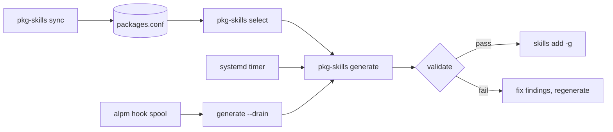

# pkg-skills orchestration

Generate and maintain per-package Claude skills from the packages installed on
this system. The heavy lifting is a compiled CLI — prefer executing it over
re-implementing any step.

## Contents

- [Pipeline](#pipeline)
- [Workflow](#workflow)
- [CLI quick reference](#cli-quick-reference)
- [Bundled references](#bundled-references)

## Pipeline



## Workflow

Copy this checklist and track progress:

```
Pipeline progress:
- [ ] Step 1: sync packages.conf
- [ ] Step 2: opt packages in
- [ ] Step 3: generate skills
- [ ] Step 4: validate results
- [ ] Step 5: enable automation
```

**Step 1 — sync:** run `pkg-skills sync`. All explicitly-installed packages land
in `$XDG_CONFIG_HOME/pkg-skills/packages.conf`, new ones commented out.

**Step 2 — opt in:** in a terminal, `pkg-skills select` (space toggles). From a
Claude session, edit packages.conf directly: uncomment a line to opt in.

**Step 3 — generate:** run `pkg-skills generate` (add `--changed-only` for
incremental). Each opted-in package becomes `~/.agents/skills/pkg-<name>/`.

**Step 4 — validate:** generation fails closed on best-practice violations; rerun
`pkg-skills validate <dir>` after manual edits and fix every error it reports.

**Step 5 — automation:** run `pkg-skills units install`, follow its printed sudo
commands for the alpm hook, then
`systemctl --user enable --now pkg-skills.timer pkg-skills-drain.path`.

## CLI quick reference

| Command | Effect |
|---------|--------|
| `pkg-skills sync` | refresh packages.conf (idempotent) |
| `pkg-skills list` | opt-in state per package |
| `pkg-skills generate [pkg…] [--changed-only\|--drain]` | build + install skills |
| `pkg-skills fetch <pkg>` | refresh one package's doc cache |
| `pkg-skills meta <pkg>` | template variables as JSON |
| `pkg-skills validate <dir>` | best-practices lint (non-zero exit on errors) |
| `pkg-skills units install\|enable\|disable\|status` | systemd/alpm automation |
| `pkg-skills status` | paths, managers, opt-in summary |

If `pkg-skills` is not on PATH, substitute `bun run <plugin>/src/index.ts`.

## Bundled references

Read on demand, one level deep:

- **[references/architecture.md](references/architecture.md)** — config/cache/state layout, data flow, design decisions
- **[references/output-skill-anatomy.md](references/output-skill-anatomy.md)** — what a generated skill contains and the style it must follow (for enrichment)
- **[references/systemd-alpm.md](references/systemd-alpm.md)** — unit files, the spool/drain bridge, troubleshooting automation
