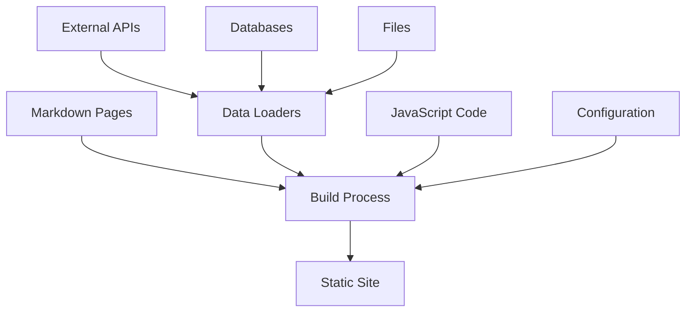

# Observable JS Reference

**Always remember to reference @./references/observablejs.md and look for snippets and examples in @./snippets/observablejs/**

## Quick Reference

- **Observable Framework**: `bun add @observablehq/framework`
- **Observable Plot**: `bun add @observablehq/plot`
- **Observable Runtime**: `bun add @observablehq/runtime`
- **Observable Inspector**: `bun add @observablehq/inspector`
- Documentation: <https://observablehq.com/framework/>
- Plot Documentation: <https://observablehq.com/plot/>
- GitHub: <https://github.com/observablehq/framework>
- GitHub Plot: <https://github.com/observablehq/plot>

## What is Observable JS?

Observable JS is a comprehensive suite of tools for building interactive data applications and visualizations:

- **Observable Framework**: A free, open-source static site generator for data apps, dashboards, and reports
- **Observable Plot**: A powerful JavaScript library implementing a layered grammar of graphics for data visualization
- **Observable Runtime**: A reactive runtime for notebooks and data applications
- **Observable Inspector**: Tools for inspecting and debugging Observable notebooks

### Key Features

- **Interactive Data Applications**: Build dynamic dashboards and reports
- **Data Loaders**: Precompute static snapshots of data at build time for instant loading
- **Multi-language Support**: JavaScript frontend with any language backend for data analysis
- **Grammar of Graphics**: Expressive API for creating complex visualizations
- **Reactive Programming**: Real-time updates and interactive elements
- **Static Site Generation**: Fast, deployable data applications

## Resources and Documentation

### Framework Documentation

- [Observable Framework](https://observablehq.com/framework/)
  - [Getting Started](https://observablehq.com/framework/getting-started)
  - [Configuration](https://observablehq.com/framework/config)
  - [Data Loaders](https://observablehq.com/framework/loaders)
  - [JavaScript](https://observablehq.com/framework/javascript)
  - [Markdown](https://observablehq.com/framework/markdown)
  - [File Attachments](https://observablehq.com/framework/files)
  - [Imports](https://observablehq.com/framework/imports)
  - [Reactivity](https://observablehq.com/framework/reactivity)
  - [Inputs](https://observablehq.com/framework/inputs)

### Plot Documentation

- [Observable Plot](https://observablehq.com/plot/)
  - [Getting Started](https://observablehq.com/plot/getting-started)
  - [What is Plot?](https://observablehq.com/plot/what-is-plot)
  - [Why Plot?](https://observablehq.com/plot/why-plot)
  - [Features](https://observablehq.com/plot/features)
    - [Plots](https://observablehq.com/plot/features/plots)
    - [Marks](https://observablehq.com/plot/features/marks)
    - [Scales](https://observablehq.com/plot/features/scales)
    - [Facets](https://observablehq.com/plot/features/facets)
  - [Marks](https://observablehq.com/plot/marks)
    - [Area](https://observablehq.com/plot/marks/area)
    - [Bar](https://observablehq.com/plot/marks/bar)
    - [Line](https://observablehq.com/plot/marks/line)
    - [Dot](https://observablehq.com/plot/marks/dot)
    - [Text](https://observablehq.com/plot/marks/text)
    - [Rule](https://observablehq.com/plot/marks/rule)
    - [Cell](https://observablehq.com/plot/marks/cell)
    - [Tip](https://observablehq.com/plot/marks/tip)

### Community Resources

- [Framework Examples](https://github.com/observablehq/framework/tree/main/examples)
  - [Hotel Bookings Dashboard](https://github.com/observablehq/framework/tree/main/examples/hotel-bookings)
  - [U.S. Dams Visualization](https://github.com/observablehq/framework/tree/main/examples/us-dams)
  - [Mortgage Rates](https://github.com/observablehq/framework/tree/main/examples/mortgage-rates)
  - [Data Loaders Examples](https://github.com/observablehq/framework/tree/main/examples)
- [Observable Forum](https://talk.observablehq.com/)
- [Observable Community](https://observablehq.com/explore)

## Core Concepts

### Observable Framework Architecture



### Framework Components

- **Pages**: Markdown files with embedded JavaScript
- **Data Loaders**: Scripts that fetch and process data at build time
- **Configuration**: `observablehq.config.js` for site-wide settings
- **File Attachments**: Static files accessible to your application
- **Imports**: External libraries and local modules

### Plot Grammar of Graphics

- **Marks**: Visual elements (bars, lines, dots, areas)
- **Channels**: Data mappings (x, y, fill, stroke)
- **Scales**: Transform data values to visual properties
- **Facets**: Split data into multiple subplots
- **Transforms**: Data manipulation before visualization

## Installation and Setup

### Framework Installation

```bash
# Create new Observable Framework project
bun create observable-framework@latest my-dashboard
cd my-dashboard

# Install dependencies
bun install

# Start development server
bun run dev

# Build for production
bun run build
```

### Plot Installation (Standalone)

```bash
# Install Observable Plot
bun add @observablehq/plot

# For TypeScript support
bun add -d @types/d3
```

### Basic Framework Configuration

```javascript
// observablehq.config.js
export default {
  title: "My Data Dashboard",
  pages: [
    {name: "Overview", path: "/overview"},
    {name: "Analysis", path: "/analysis"}
  ],
  root: "src",
  output: "dist"
};
```

## Framework Usage Patterns

### Basic Page Structure

```markdown
# My Dashboard

Here's a simple visualization:

```js
const data = [
  {name: "A", value: 10},
  {name: "B", value: 20},
  {name: "C", value: 15}
];

Plot.plot({
  marks: [
    Plot.barY(data, {x: "name", y: "value"})
  ]
})
```

### Data Loaders

```javascript
// data/sales.csv.js
import {csvFormat} from "d3-dsv";

// Fetch data from API
const response = await fetch("https://api.example.com/sales");
const sales = await response.json();

// Transform and output as CSV
process.stdout.write(csvFormat(sales));
```

### File Attachments

```javascript
// Load CSV data
const sales = FileAttachment("data/sales.csv").csv({typed: true});

// Load JSON data
const config = FileAttachment("config.json").json();

// Load image
const chart = FileAttachment("chart.png").image();
```

### Interactive Inputs

```javascript
// Range input
const threshold = view(Inputs.range([0, 100], {
  label: "Threshold",
  value: 50
}));

// Select dropdown
const category = view(Inputs.select(
  ["Electronics", "Clothing", "Books"], 
  {label: "Category"}
));

// Search input
const searchQuery = view(Inputs.search(data, {
  placeholder: "Search products..."
}));
```

### Reactive Programming

```javascript
// Reactive computation
const filteredData = data.filter(d => d.value > threshold);

// Mutable state
const count = Mutable(0);

// Event handling
const increment = () => count.value++;
const decrement = () => count.value--;

// Display reactive values
html`<p>Count: ${count}</p>`
```

## Plot Usage Patterns

### Basic Charts

```javascript
// Line chart
Plot.lineY(data, {x: "date", y: "value"}).plot()

// Bar chart
Plot.barY(data, {x: "category", y: "count"}).plot()

// Dot plot
Plot.dot(data, {x: "x", y: "y", fill: "category"}).plot()

// Area chart
Plot.areaY(data, {x: "date", y: "value"}).plot()
```

### Advanced Visualizations

```javascript
// Multi-series line chart
Plot.plot({
  marks: [
    Plot.line(data, {
      x: "date", 
      y: "value", 
      stroke: "series",
      z: "series"
    }),
    Plot.ruleY([0])
  ]
})

// Faceted charts
Plot.plot({
  facet: {data: sales, x: "region"},
  marks: [
    Plot.barY(sales, {x: "month", y: "revenue"}),
    Plot.frame()
  ]
})

// Stacked area chart
Plot.plot({
  marks: [
    Plot.areaY(data, {
      x: "date",
      y: "value",
      fill: "category"
    }),
    Plot.ruleY([0])
  ]
})
```

### Data Transformations

```javascript
// Grouping and aggregation
Plot.plot({
  marks: [
    Plot.barY(data, Plot.groupX({y: "sum"}, {
      x: "category",
      y: "value"
    }))
  ]
})

// Binning
Plot.plot({
  marks: [
    Plot.rectY(data, Plot.binX({y: "count"}, {
      x: "value",
      thresholds: 20
    }))
  ]
})

// Sorting and filtering
Plot.plot({
  marks: [
    Plot.barY(data, {
      x: "name",
      y: "value",
      sort: {x: "y", reverse: true}
    })
  ]
})
```

### Interactive Features

```javascript
// Tooltips
Plot.plot({
  marks: [
    Plot.dot(data, {
      x: "x",
      y: "y",
      fill: "category",
      tip: true
    })
  ]
})

// Crossfilter-style interactions
Plot.plot({
  marks: [
    Plot.dot(data, Plot.pointer({
      x: "x",
      y: "y",
      fill: "category"
    }))
  ]
})
```

## Integration Patterns

### With D3.js

```javascript
import * as d3 from "d3";
import * as Plot from "@observablehq/plot";

// Use D3 for data processing
const processedData = d3.rollup(
  data,
  v => d3.sum(v, d => d.value),
  d => d.category
);

// Visualize with Plot
Plot.plot({
  marks: [
    Plot.barY(Array.from(processedData), {
      x: ([category]) => category,
      y: ([, sum]) => sum
    })
  ]
})
```

### With Other Libraries

```javascript
// Leaflet maps
import L from "leaflet";

const map = L.map("map").setView([51.505, -0.09], 13);
L.tileLayer("https://{s}.tile.openstreetmap.org/{z}/{x}/{y}.png").addTo(map);

// Deck.gl 3D visualizations
import {Deck} from "@deck.gl/core";
import {ScatterplotLayer} from "@deck.gl/layers";

const deck = new Deck({
  container: "map",
  layers: [
    new ScatterplotLayer({
      data: points,
      getPosition: d => [d.longitude, d.latitude],
      getRadius: d => d.size
    })
  ]
});
```

### Database Integration

```javascript
// data/analytics.csv.js
import {Client} from "pg";

const client = new Client({
  connectionString: process.env.DATABASE_URL
});

await client.connect();

const result = await client.query(`
  SELECT date, revenue, region
  FROM sales
  WHERE date >= NOW() - INTERVAL '30 days'
  ORDER BY date
`);

await client.end();

// Output as CSV
import {csvFormat} from "d3-dsv";
process.stdout.write(csvFormat(result.rows));
```

## Performance Optimization

### Data Loading Best Practices

```javascript
// Use data loaders for expensive operations
// data/processed-sales.json.js
const rawData = await fetch("https://api.slow-service.com/data");
const processed = await processLargeDataset(rawData);

// Cache results at build time
process.stdout.write(JSON.stringify(processed));
```

### Efficient Plotting

```javascript
// Sample large datasets
const sampled = data.length > 10000 
  ? d3.sample(data, 5000) 
  : data;

// Use appropriate mark types
Plot.plot({
  marks: [
    // Use dot for scatter plots with many points
    Plot.dot(sampled, {x: "x", y: "y", r: 1}),
    
    // Use rect for heatmaps
    Plot.rect(aggregated, {
      x: "category",
      y: "subcategory", 
      fill: "value"
    })
  ]
})
```

### Memory Management

```javascript
// Clean up large datasets after use
invalidation.then(() => {
  largeDataset = null;
  map.remove();
});

// Use streams for very large datasets
import {csvParseRows} from "d3-dsv";

const stream = createReadStream("large-file.csv");
const parser = csvParseRows();

for await (const chunk of stream) {
  // Process in chunks
}
```

## Code Examples Location

Comprehensive examples available in `./snippets/observablejs/`:

- Basic Framework setup and configuration
- Data loader implementations
- Interactive dashboard patterns
- Plot chart examples and customizations
- Integration with external libraries
- Database connectivity patterns
- Performance optimization techniques
- Deployment configurations
- Testing strategies

## Schema and Type Definitions

Type definitions and validation schemas in `./snippets/observablejs/schemas/`:

- Framework configuration schemas
- Data loader type definitions  
- Plot API type definitions
- Custom component interfaces

## Linting and Formatting

Latest configuration files in `./snippets/observablejs/linting/`:

- Biome configuration for Observable projects
- TypeScript strict mode settings
- Framework-specific linting rules
- Plot.js coding standards

## Migration Guides

### From Observable Notebooks

```javascript
// Observable Notebook cell
data = FileAttachment("data.csv").csv()

// Framework equivalent
const data = FileAttachment("data/data.csv").csv({typed: true});
```

### From D3.js

```javascript
// D3.js approach
const svg = d3.select("body")
  .append("svg")
  .attr("width", 800)
  .attr("height", 400);

svg.selectAll("rect")
  .data(data)
  .enter()
  .append("rect")
  .attr("x", (d, i) => i * 50)
  .attr("y", d => 400 - d.value * 10)
  .attr("width", 40)
  .attr("height", d => d.value * 10);

// Plot equivalent  
Plot.plot({
  width: 800,
  height: 400,
  marks: [
    Plot.barY(data, {x: (d, i) => i, y: "value"})
  ]
})
```

### From Other Frameworks

```javascript
// Chart.js approach
new Chart(ctx, {
  type: 'line',
  data: {
    labels: data.map(d => d.date),
    datasets: [{
      data: data.map(d => d.value)
    }]
  }
});

// Plot equivalent
Plot.lineY(data, {x: "date", y: "value"}).plot()
```

## Deployment Options

### Static Hosting

```bash
# Build static site
bun run build

# Deploy to any static host
# - Netlify
# - Vercel  
# - GitHub Pages
# - AWS S3
# - Firebase Hosting
```

### Serverless Functions

```javascript
// api/data.js (Vercel)
export default async function handler(req, res) {
  const data = await fetchFromDatabase();
  res.json(data);
}

// Use in data loader
// data/live-data.json.js
const response = await fetch(`${process.env.BASE_URL}/api/data`);
const data = await response.json();
process.stdout.write(JSON.stringify(data));
```

### Docker Deployment

```dockerfile
FROM node:18-alpine
WORKDIR /app
COPY package*.json ./
RUN npm install
COPY . .
RUN npm run build
EXPOSE 3000
CMD ["npm", "run", "preview"]
```

## Best Practices

### Project Structure

```
my-dashboard/
├── observablehq.config.js
├── package.json
├── src/
│   ├── index.md              # Home page
│   ├── data/                 # Data loaders
│   │   ├── sales.csv.js
│   │   └── users.json.js
│   ├── components/           # Reusable components
│   │   ├── chart.js
│   │   └── table.js
│   └── assets/              # Static assets
│       ├── style.css
│       └── logo.png
└── .observablehq/           # Generated files
```

### Code Organization

```javascript
// components/sales-chart.js
export function salesChart(data, {width = 640} = {}) {
  return Plot.plot({
    width,
    marks: [
      Plot.barY(data, {x: "month", y: "revenue"}),
      Plot.ruleY([0])
    ]
  });
}

// Use in pages
import {salesChart} from "./components/sales-chart.js";

salesChart(sales, {width: 800})
```

### Data Management

```javascript
// Centralized data loading
const sales = FileAttachment("data/sales.csv").csv({typed: true});
const users = FileAttachment("data/users.json").json();

// Derived data
const monthlySales = d3.rollup(
  sales,
  v => d3.sum(v, d => d.revenue),
  d => d3.utcMonth(d.date)
);
```

### Testing

```javascript
// test/charts.test.js
import {salesChart} from "../src/components/sales-chart.js";
import assert from "assert";

const testData = [
  {month: "Jan", revenue: 1000},
  {month: "Feb", revenue: 1200}
];

const chart = salesChart(testData);
assert(chart instanceof SVGElement);
```

## Common Patterns

### Dashboard Layout

```javascript
html`
<div class="grid grid-cols-2 gap-4">
  <div class="card">
    <h2>Sales Overview</h2>
    ${salesChart(sales)}
  </div>
  <div class="card">
    <h2>User Growth</h2>
    ${userChart(users)}
  </div>
</div>
`
```

### Real-time Updates

```javascript
// Use intervals for live data
const now = Generators.observe(notify => {
  const timer = setInterval(notify, 1000);
  return () => clearInterval(timer);
});

// Update charts based on current time
const recentData = data.filter(d => 
  d.timestamp > now - 60 * 1000
);
```

### Responsive Design

```javascript
// Use resize observer
const chart = resize((width) => 
  Plot.plot({
    width,
    marks: [
      Plot.barY(data, {x: "category", y: "value"})
    ]
  })
);

html`<div class="chart-container">${chart}</div>`
```
